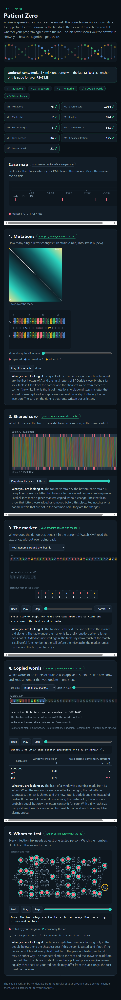

# Assignment 4. Patient Zero

**Student ID:** 251888  
**Name:** Abdurrakhim Yestaiuly  
**Group:** SE-2532

## Program Output

```text
Mutations: 78
Shared core: 1084
Marker hits: 7
First hit: 924
Border length: 3
Shared words: 501
Tests needed: 34
Cheapest testing: 125
Longest chain: 21
```

## Outbreak Report



## Mission 1. Edit Distance

I used dynamic programming to calculate the minimum number of changes between two strains.

The cell d[i][j] represents the minimum operations needed to change the first i characters of A into the first j characters of B.

If characters match, I use the diagonal value. Otherwise, I take the minimum of insertion, deletion and replacement, plus one.

## Mission 2. Longest Common Subsequence

LCS finds the longest sequence of characters in the same order, but they do not need to be consecutive.

Unlike LCS, the longest common substring requires characters to be next to each other.

## Mission 3. KMP

The prefix function finds the length of the longest proper prefix that is also a suffix.

KMP uses this function to avoid unnecessary comparisons without moving backwards in the text.

My border length is 3, meaning the first and last 3 characters of the marker are equal.

## Mission 4. Rabin-Karp

Rabin-Karp uses a rolling hash to compare substrings efficiently.

When hashes match, I compare the actual characters because different strings can have the same hash.

Many hash collisions increase the number of comparisons and make the algorithm slower.

## Mission 5. Tree DP

I used two DP states for each person:

- Not tested: all children must be tested.
- Tested: each child can be tested or not, depending on the minimum cost.

Greedy does not always work because a locally good choice may increase the total cost.

For the longest chain, I used DFS to find the two longest downward paths from each node.

## Benchmark Results

### Naive Search vs KMP

| Text length | Naive | KMP |
|---|---|---|
| 20000 | 55.3 ms | 2.3 ms |
| 40000 | 121.6 ms | 0.7 ms |
| 80000 | 244.3 ms | 0.5 ms |

### Edit Distance

| Length | Time |
|---|---|
| 500 | 7.1 ms |
| 1000 | 9.0 ms |
| 2000 | 21.0 ms |
| 4000 | 65.5 ms |

The naive search becomes slower as the text grows, while KMP avoids repeated comparisons. Small KMP timing differences may be caused by JVM warm-up.

Edit distance becomes slower for longer strings because it fills a two-dimensional DP table.

## Time and Space Complexity

| Algorithm | Time | Space |
|---|---|---|
| Edit Distance | O(n * m) | O(n * m) |
| LCS | O(n * m) | O(n * m) |
| KMP | O(n + m + h) | O(m + h) |
| Rabin-Karp | O(n + m) average | O(m) |
| Tree DP | O(v) | O(v) |
| Longest Chain | O(v) | O(v) |

Here, n and m are string lengths, h is the number of matches, and v is the number of people. Rabin-Karp assumes a fixed window size and few hash collisions; in the worst case it can take O(n * m * k), where k is the window size.

## AI Use

I used ChatGPT to help and understand the algorithms and prepare the README. I reviewed the code and tested it using Check.java and Bench.java.
